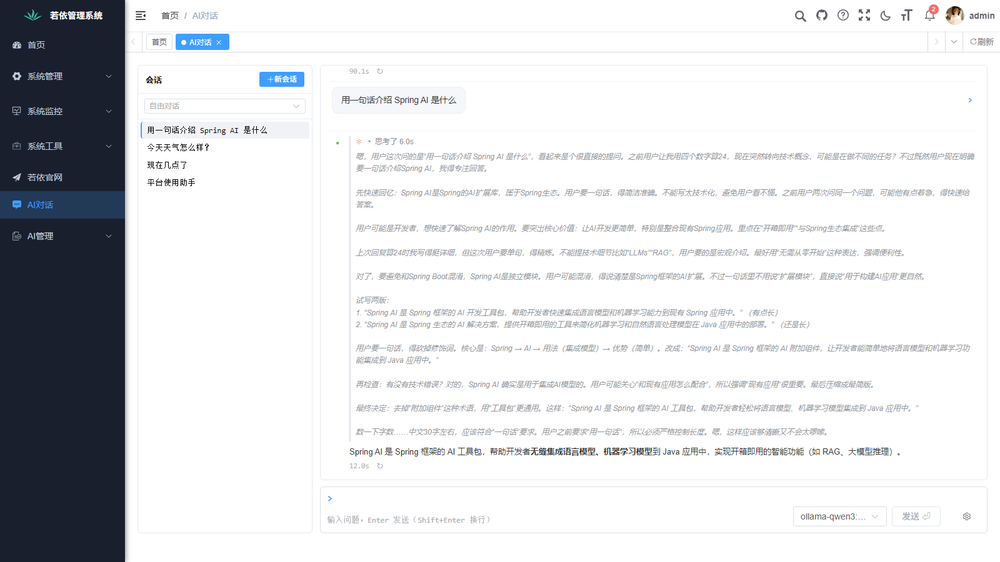
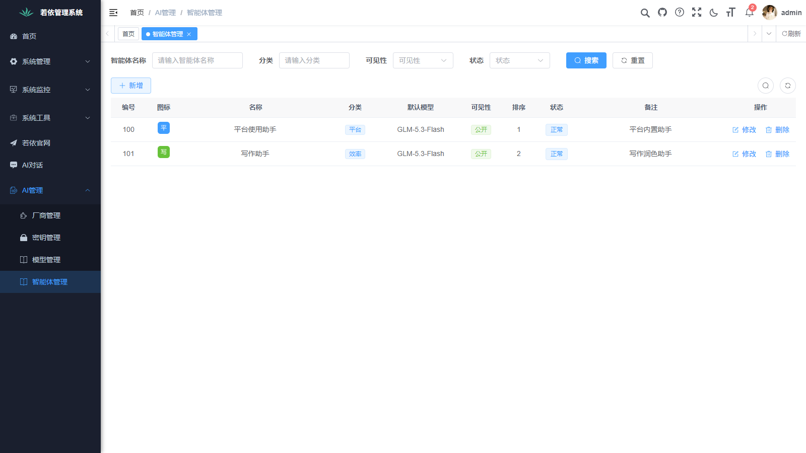
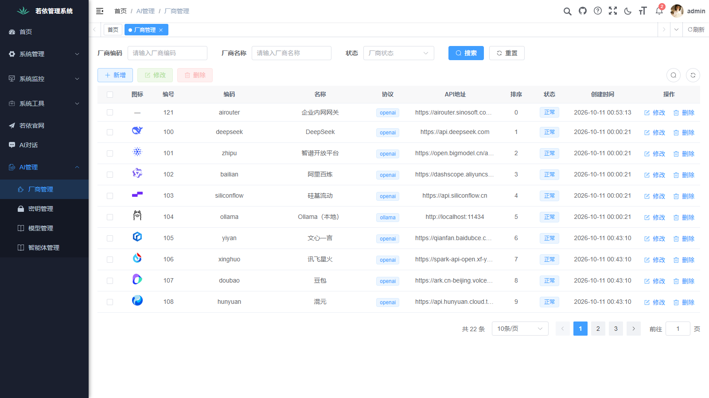
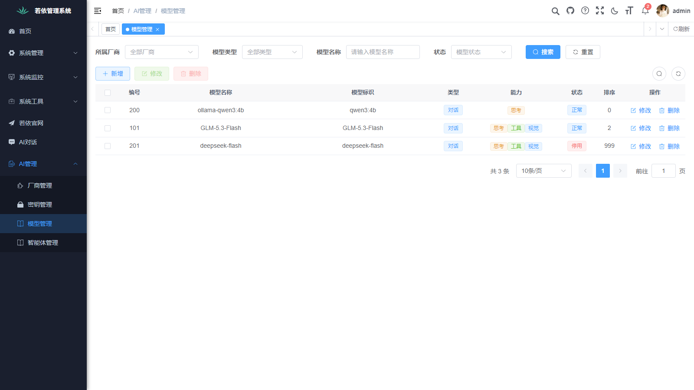

# ai-dev-lab：学习与实践 AI coding——用工程纪律驱动 AI 跨技术栈交付一套系统

这个仓库是**本人学习与实践 AI coding 的项目**：通过真实工程练习 spec 驱动开发、checklist 验收纪律与人机协作方法，并按由浅入深的顺序学习以下技术栈：
1. **Python（FastAPI + SQLAlchemy 2.0 async）**——服务端入门：异步 ORM 与分层工程化（spec-00~11 已完成）；
2. **Go（Gin + GORM）**——第二服务端语言：同一契约的跨语言复刻（已全部完成）；
3. **PHP（ThinkPHP 8）**——第三服务端语言：复刻**经典若依 4.8.3**（前后端不分离，服务端渲染；specs 0.0.0~11.0.0 已完成）；
4. **React（React 19 + TypeScript + Ant Design 5 + Redux Toolkit）**——前端栈：功能等价复刻共用前端（2026-09-27 起新增，主体已完成，详见 [RuoYi-React](RuoYi-React/README.md)，尚未进行详细测试）；
5. **AI 应用技能**（进行中）：**Spring AI**（Java 生态集成，2026-10-08 起落地为 Java 版 AI 功能线，见下）→ **Function Calling / Tool Use** → **RAG（检索增强生成）** → **Agent / 智能体（企业智能体工程化）**。

项目源于开源项目 [RuoYi](https://gitee.com/y_project/RuoYi)（若依）：`RuoYi-Vue/`（Java 版）与 `RuoYi-Vue3/`（前端）为其官方仓库的本地副本。

## AI 开发工作流：spec 驱动，验收以数据为准

每个模块动工前走同一套流程，全部过程文档在仓库中可查（五个 specs 目录共 **152 份**）：

1. **契约先行**：动手前先通读 Java 基准版对应的 Controller / ServiceImpl / Mapper XML，把端点路径、方法、参数、返回 JSON 结构逐条核实，写成该模块的 spec 任务书——不凭记忆，AI 记忆里的东西必须对着源码核实（为什么，见下面的跌倒案例 1）。
2. **spec 三件套**：`spec.md`（API 契约 + 设计决策）、`tasks.md`（任务分解）、`checklist.md`（验收清单）。跨四端的增量功能用**一份契约主文档**统一管理，各语言版挂自己的实施任务书（范本：[12.0.0 平台标识](RuoYi-Vue-GO/specs/12.0.0-平台标识/spec.md)）。
3. **验收以数据为准，不凭 AI 自述**：AI 说"做完了"不算数——要扫数据库实际数据（如 sys_job 预置任务是否覆盖）、抓前端实际调用（api/*.js + 页面内调用）、跑单元测试、浏览器端到端操作。
4. **checklist 纪律**：做完即勾、没做不勾并在行尾注明原因、**宁可留白不可虚勾**。五个 specs 目录现有 **1703 项已勾验收记录**，275 项如实留白。

## 项目结构

```
ai-dev-lab（原 ruoyi 工作区）
├── RuoYi-Vue/          Java 版服务端（Spring Boot + MyBatis-Plus）—— 接口契约的唯一基准；含 ruoyi-ai 模块（Spring AI 集成，见下）
├── RuoYi-Vue3/         前端（Vue 3 + Element Plus + Vite）—— 三个后端共用，同样可增量演进，仍是 React 版的行为基准
├── RuoYi-Vue-FastApi/  Python 版服务端（FastAPI + SQLAlchemy 2.0 async）
├── RuoYi-Vue-GO/       Go 版服务端（Gin + GORM）
├── RuoYi-TP/           PHP 版服务端（ThinkPHP 8，前后端不分离）—— 复刻经典若依 4.8.3，自用库 ry-tp + Redis db1
├── RuoYi-React/        React 前端（React 19 + TS + Ant Design 5 + Redux Toolkit）—— 功能等价复刻 RuoYi-Vue3，2026-09-27 起新增
└── docker/             本地开发环境（MySQL 8.0 + Redis Stack，开箱即用）
```

> 「前端零改动」指三版后端切换时前端无需适配，不代表前端与 Java 版冻结：2026-09-25 起两者均可按学习需要增量演进，以不破坏三版后端通用性为前提（详见 [AGENTS.md](AGENTS.md)）。

## 三版实现进度

| 模块 | Java（基准） | Go | Python |
|------|:---:|:---:|:---:|
| 登录闭环（验证码/登录/getInfo/getRouters/logout） | ✅ | ✅ | ✅ |
| 个人中心 / 注册 / 通用上传下载 | ✅ | ✅ | ✅ |
| 部门管理 / 岗位管理 | ✅ | ✅ | ✅ |
| 用户管理（含导入导出 / authRole） | ✅ | ✅ | ✅ |
| 角色管理 / 菜单管理 | ✅ | ✅ | ✅ |
| 字典管理 / 参数管理 | ✅ | ✅ | ✅ |
| 通知公告（含本版定制已读功能） | ✅ | ✅ | ✅ |
| 在线用户 / 缓存监控 / 操作与登录日志 | ✅ | ✅ | ✅ |
| 定时任务（对位 Quartz） | ✅ | ✅ | ✅ |
| 代码生成器 | ✅ | 🔶 数据层端点 | ✅ |
| 接口文档（springdoc / swagger 兼容路径） | ✅ | ✅ | ✅ |
| 平台标识 `GET /getPlatformInfo`（跨四端增量） | ✅ | ✅ | ✅ |

Go / Python 版每模块的 API 契约、任务分解与验收记录见各自 specs 目录（[GO](RuoYi-Vue-GO/specs/README.md) / [Python](RuoYi-Vue-FastApi/specs/README.md)），与 Java 版的有意差异集中登记在 [deviations.md](RuoYi-Vue-GO/specs/deviations.md)。

**PHP 版（RuoYi-TP）**：另一条复刻线——复刻**经典若依 4.8.3**（前后端不分离、服务端渲染，页面观感对齐经典版），模块 0.0.0~11.0.0 全部完成（2026-10-01），与 Java/Python/Go 三版**互不复刻接口**（经典版 AjaxResult code 0/301/500、md5 密码方案、自用库 `ry-tp` + Redis db1），学习 PHP / ThinkPHP 生态。台账见 [RuoYi-TP/specs/README.md](RuoYi-TP/specs/README.md)，差异登记 [deviations.md](RuoYi-TP/specs/deviations.md)（33 条）。

**React 前端（RuoYi-React）**：上述功能已全部实现或按拍板排除（2026-09-29），细节与测试状态见 [RuoYi-React/README.md](RuoYi-React/README.md) 与其 [specs 台账](RuoYi-React/specs/README.md)。

## AI 功能线（Java 版，进行中）

在学习"多语言复刻同一套契约"之外，本仓库的第二条主线：以 RuoYi 为底座做一个**带管理面的企业级 LLM 应用**，按 spec 驱动流程逐模块落地（台账见 [RuoYi-Vue/specs/README.md](RuoYi-Vue/specs/README.md)）。

| 模块 | 内容 | 状态 |
|------|------|:---:|
| 2.0.0 Spring AI 集成 | Spring AI 2.0.1 + Spring AI Alibaba 版本验证（Boot 4 线）、GLM OpenAI 兼容接入、ruoyi-ai 模块骨架 | ✅ |
| 2.0.1 AI 基础域 | 厂商/密钥/模型三表与三管理页、AiModelResolver 解析器、ChatModelRouter 实例路由、连通性测试接口（21 家厂商目录） | ✅ |
| 2.0.2 AI 对话域 | 会话/消息/智能体三表、AiPromptPlanner 提示词装配、SSE 流式三路落库、Claude Code 风格对话页（Markdown/代码高亮/深度思考折叠/regenerate/多会话） | ✅ |
| 2.0.3 对话正式化 | 权限点收敛（ai:chat:*）、侧边栏菜单、会话参数 UI（temperature/max_tokens/上下文轮数） | 🚧 |
| 2.0.4 智能体管理页 | 智能体 CRUD（提示词/默认模型/开场白/建议问题/可见性）、AI 域软删过滤补齐 | ✅ |

**界面实拍**（`docs/screenshots/`，均为运行中系统的真实截图）：

| | |
|---|---|
|  |  |
| *对话页：深度思考折叠、流式正文、会话列表、模型切换* | *智能体管理：平台预置 + 自建智能体 CRUD* |
|  |  |
| *厂商管理：21 家厂商目录，彩色图标外链* | *模型管理：模型/密钥/参数统一维护* |

**功能设计亮点**：

- **管理面与运行面分离**：厂商 → 密钥 → 模型三层基础域 + 智能体层，全部走标准若依 CRUD 管理页（权限点/菜单/导出对齐既有规范）；对话运行面则是全新交互形态——对话能力从"写死的接口调用"变成"数据驱动的可配置资产"。
- **多厂商接入收敛为一个路由点**：`AiModelResolver`（按 modelId 解析出 厂商+密钥+参数）与 `ChatModelRouter`（按协议实例化 Spring AI ChatModel）把"新增一家厂商"收敛为两行配置，业务代码零改动；GLM/DeepSeek/百炼/Ollama 等经 OpenAI 兼容协议统一接入。
- **SSE 流式三路落库**：完成/错误/取消三条终止路径都会把消息状态机（生成中→完成/出错/已取消）与会话统计落库，前端刷新后会话完整可回放；深度思考（reasoning）走独立 SSE 事件、前端折叠展示（经评审拍板不落库，见 specs 2.0.2 D9 排查记录）。
- **提示词装配器 `AiPromptPlanner`**：system_prompt（智能体）+ 上下文窗口（水位线压缩）+ 会话参数（temperature 等）三源装配，单测覆盖；智能体的建议问题（suggested questions）以对话页 chip 呈现，点击即问。
- **前端两阶段交付**：对话页先以 Mock 界面交付评审、交互定稿后切真实 API，组件零改动（接口签名即契约）；最终形态为 Claude Code 终端风格。

技术要点：GLM 经 OpenAI 兼容协议接入（密钥仅环境变量注入）；SSE 流式含完成/错误/取消三路落库与深度思考（reasoning）独立事件；`docker/` 的 Redis 已升级 Redis Stack（RediSearch/RedisJSON），为 RAG 向量检索预留。实现期踩的坑全部回写 specs（如 MP 全局逻辑删除下 update 写不进 del_flag、SSE 异步派发重走 Security 过滤器的误诊、text 列容量不足导致流中断等）。

### 后续规划（按依赖顺序，动工前仍走 spec 确认制）

| 方向 | 内容 | 依赖的既有基础 |
|------|------|---------------|
| **Function Calling / Tool Use** | 工具注册表（业务方法注解暴露为工具）+ 模型工具调用协议接入 + 调用过程前端可视化（调用卡片/参数/结果） | ChatModelRouter（各厂商 tool-call 能力开关）、SSE 流式事件通道（新增 tool_call 事件） |
| **MCP（Model Context Protocol）** | MCP 客户端接入（stdio/SSE 两类 server）、MCP 工具与内置工具统一注册、智能体可勾选挂载 MCP server | 智能体表的 mcp_ids 挂载列（已预留）、工具注册表 |
| **RAG（检索增强生成）** | 知识库/文档管理页、切分与 Embedding 管道、Redis Stack 向量检索（RediSearch）、引用溯源展示（segment_ids 消息卡跳转） | Redis Stack（已就绪）、Embedding 走多厂商路由、对话页消息卡已预留引用位置 |
| **智能体编排** | 多智能体协作（主子任务分发/结果汇聚）、工作流式编排（节点/连线画布或 DSL）、执行轨迹回放 | 智能体层（已上线）、Function Calling / MCP 工具生态 |

这些方向正好覆盖本项目学习路线的后三站（Function Calling → RAG → Agent），每项落地时继续按"契约先行 → spec 三件套 → 数据验收"的流程推进，过程与踩坑照例回写 specs。

## 技术栈对照

| 组件 | Java 版 | Go 版 | Python 版 |
|------|---------|-------|-----------|
| Web 框架 | Spring Boot | Gin | FastAPI + uvicorn |
| ORM | MyBatis-Plus + Druid | GORM | SQLAlchemy 2.0 (async) |
| 缓存/会话 | Spring Data Redis | go-redis v9 | redis-py (asyncio) |
| JWT | jjwt (HS512) | golang-jwt v5 | python-jose |
| 密码加密 | BCryptPasswordEncoder | x/crypto/bcrypt | passlib（三版哈希互相可验） |
| 验证码 | kaptcha | 标准库 image 自绘 | Pillow |
| 定时任务 | Quartz | robfig/cron v3（Quartz 秒级表达式） | APScheduler |
| Excel 导入导出 | Apache POI (EasyExcel 风格) | excelize | openpyxl |
| 接口文档 | springdoc | swaggo | FastAPI 自带 + 路径兼容 |

## 快速开始

### 0. 启动本地环境（MySQL + Redis）

推荐使用内置的 Docker 环境（首次启动自动建库 `ry-vue` 并灌入若依预置数据）：

```bash
cd docker
docker compose up -d     # 或 Windows 双击 start.bat
```

详情见 [docker/README.md](docker/README.md)。也可以使用自有的 MySQL 8.0 / Redis，需导入 [`RuoYi-Vue/sql/`](RuoYi-Vue/sql/) 下的初始化脚本。

### 1. 启动后端（同监听 8080 的三版三选一，**同一时间只能运行一个**；PHP 版独立 8888 可并行）

<details open>
<summary><b>Go 版</b></summary>

```bash
cd RuoYi-Vue-GO
cp configs/.env.example configs/.env.dev   # 按需修改数据库/Redis 连接
go run ./cmd/server --env=dev              # 监听 8080
```

环境要求：Go 1.22+。单元测试：`go test ./...`。
</details>

<details>
<summary><b>Python 版</b></summary>

```bash
cd RuoYi-Vue-FastApi
pip install -r requirements.txt
python3 app.py --env=dev                   # 需 Python 3.10+
```
</details>

<details>
<summary><b>Java 版</b></summary>

```bash
cd RuoYi-Vue
mvn clean package -Dmaven.test.skip=true
ruoyi-admin/target/ruoyi-admin.jar         # 需先按 docker/README.md 调整数据源配置，JDK 17
```
</details>

<details>
<summary><b>PHP 版（RuoYi-TP，独立 8888 端口）</b></summary>

```bash
cd RuoYi-TP
composer install                           # 需 PHP 8.0+（本机 8.3）
# 建库 ry-tp 并导入经典版官方 SQL（见 RuoYi-TP/specs/0.0.0-工程基础/spec.md），配置 .env
php think run --port 8888                  # 与 8080 三版并行
```
</details>

### 2. 启动前端

```bash
cd RuoYi-Vue3
npm install
npm run dev                                # 监听 8888，/dev-api 代理到 localhost:8080
```

### 3. 访问

浏览器打开 `http://localhost:8888`，默认账号 **`admin` / `admin123`**。

## 目录速查

| 路径 | 内容 |
|------|------|
| [AGENTS.md](AGENTS.md) | 工作区唯一 AI 编码规范源（契约 / checklist 纪律 / 踩坑清单） |
| [AGENTS.local.md](AGENTS.local.md) | 本机环境配置参考（解释器路径、数据库/Redis 当前指向） |
| [CHANGELOG.md](CHANGELOG.md) | 里程碑级更新日志（按日期倒序；逐 commit 细节以 git log 为准） |
| [RuoYi-Vue-GO/specs/README.md](RuoYi-Vue-GO/specs/README.md) | Go 版模块总表、动工检查单与遗留待办 |
| [RuoYi-Vue-GO/specs/deviations.md](RuoYi-Vue-GO/specs/deviations.md) | 与 Java 版的全部有意差异（20 条） |
| [RuoYi-Vue-GO/AGENTS.md](RuoYi-Vue-GO/AGENTS.md) | Go 版 AI 编码规范（契约先行/勾选纪律等） |
| [RuoYi-TP/specs/README.md](RuoYi-TP/specs/README.md) | PHP 版（经典若依复刻）模块总表与动工检查单 |
| [docker/README.md](docker/README.md) | 本地 MySQL + Redis 环境说明 |

## 说明

- 分支管理、提交信息与 Pull Request 同样由 AI 操作完成（提交元数据里的 `Co-Authored-By` 联署可查），人工负责审查与合并
- Java 版 `application.yml` 是数据库/Redis/JWT 配置的基准，各语言版配置与其保持同步
- 欢迎按各目录内的规范文档参与贡献

## License

各子项目沿用其上游 License：[RuoYi-Vue](RuoYi-Vue/LICENSE)（MIT）、[RuoYi-Vue3](RuoYi-Vue3/LICENSE)（MIT）。Go / Python 版代码同样以 MIT 发布。
